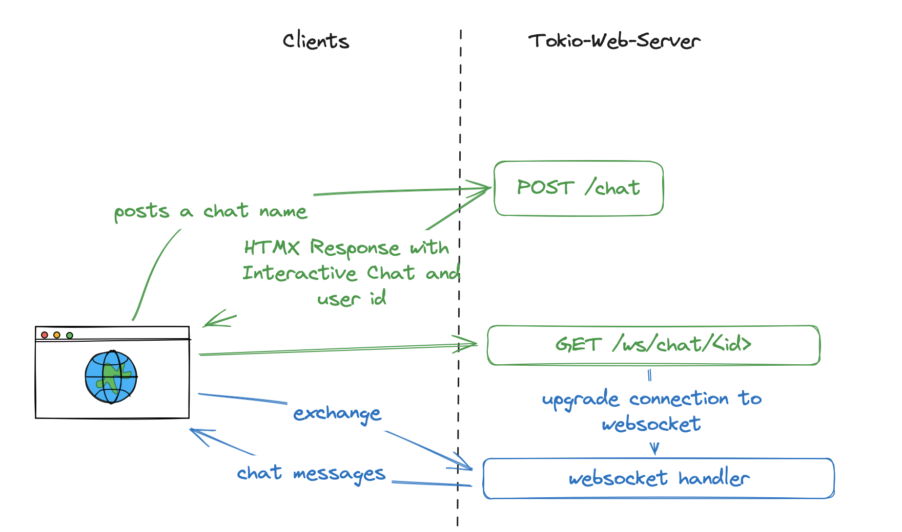
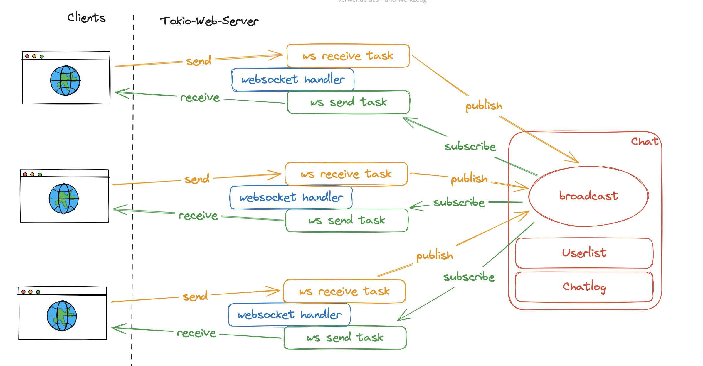

Today I had the idea to extend my [async rust webserver demo](https://github.com/tsmt09/tokio-web-demo) with an additional feature of a chat. In this small post I want to discuss why I think a chat functionality is a useful showcase for a rust webserver, but also show how I did implement it, since it's a very easy feature to develop using the tokio runtime.

You can easily try it out on your machine by downloading the `docker-compose.yaml` ([right click + save](https://raw.githubusercontent.com/tsmt09/tokio-web-demo/main/docker-compose.yaml)), store it in a folder called `tokio-web-demo` and typing `docker compose up` in your terminal. Make sure you navigate to your created folder first. You can find the webserver at `http://localhost:8123`.



## Why

A chat functionality serves as an excellent showcase for a Rust webserver because it utilizes different I/O patterns, which include sockets, locks, and broadcast channels. This variety of I/O patterns demonstrates the versatility and capabilities of the webserver in handling various types of data communication and synchronization.
Moreover, implementing a chat feature allows us to demonstrate an important aspect of asynchronous programming: the ability to continue processing chat messages even when the runtime temporarily blocks and then resumes. This showcases the robustness and efficiency of the asynchronous model in handling concurrent operations, which is particularly valuable in real-time communication scenarios like chat applications.

## Implementation

The implementation of the chat functionality in this demo is intentionally kept very simplistic. This approach allows us to focus on the core concepts and functionality without getting bogged down in complex details.
To achieve this, the implementation leverages htmx for dynamic HTML updates, WebSockets for real-time bidirectional communication between browser and webserver, and broadcast channels for efficiently distributing messages to multiple connected clients. This combination of technologies enables a responsive and interactive chat experience while demonstrating the power and simplicity of using the tokio runtime for asynchronous operations in Rust.

### Disclaimer
The article assumes that readers know a little bit about Rust and HTML and do have a general idea of the concepts of [asynchronous Rust programming](https://tokio.rs/), [HTMX](https://htmx.org/) and [WebSockets](https://de.wikipedia.org/wiki/WebSocket). If you're unfamiliar with these concepts, please click the links to learn more.

### ChatMessage

The ChatMessage struct represents a single ChatMessage and is very simple.

```rust
struct ChatMessage {
    timestamp: NaiveDateTime,
    username: String,
    message: String,
}
```

It has a simple timestamp, a username and a message. It implements two functions:

```rust
impl ChatMessage {
    /// Used to generate message representations in the actual program log
    fn log(&self) -> String {
        /// ...
    }
    /// On the WebSocket, we reply with HTML to be used with the HTMX Rust extension
    fn websocket_reply(&self) -> String {
        /// ...
    }
}
```

### Chat

To send a chatmessage between multiple clients, we use another struct called `Chat`. Different chats can be instanciated in one binary, but practically this is used as a singleton. If you would extend the tool later to support multiple Chat channels, you would likely rename `Chat` to `Channel`.

```rust
pub struct Chat {
    // The actual broadcast channel
    tx: tokio::sync::broadcast::Sender<ChatMessage>,
    // A set of unique users which are connected,
    // so two clients cannot claim the same name
    users: RwLock<HashSet<String>>,
    // A Fist-In-First-Out log of ChatMessages, 
    // to also display for new connected users
    log: RwLock<VecDeque<ChatMessage>>,
}
```

For a tokio broadcast channel, it is sufficient to just store the "Sender" structure on creation, since new "Receivers" can be derived from the Sender calling `let recv = chat.tx.subscribe();`. The users and log are stored in a `RwLock` structure, since multiple threads might be using the inner collections and `read()` and `write()` access need to be properly synchronized here. Also, it is important to use `tokio::sync::RwLock` instead of `std::sync::RwLock`, since the first one is a non-blocking and async implentation. Finally, I decided to use a `VecDeque` instead of `Vec`, so I can add messages with `push_back()` and remove them on the other hand with `pop_front()` if the structure exceeds it's limits.

### Creating the WebSocket using HTMX

The webserver is implemented using the library `axum`. The design of the chat interaction between client and server is the following:



#### Logging into the Chatroom

When a user submits the login form, it invokes the `chat::chat()` function.

```rust
pub async fn chat(State(chat): State<Arc<Chat>>, Form(f): Form<Chatform>) -> impl IntoResponse {
    // join chat
    if f.name.to_lowercase() == "system" {
        return "Username 'system' is not allowed".into();
    }
    if let Err(e) = chat.join(f.name.clone()).await {
        return e.into();
    };
    format!(
        // magix HTMX response
    )
}
```

The chat function first checks if the provided username is a case insensitive version of "system", which is a reserved username. If this is the case, it will respond with an error. If the username is okay, the the user "joins" the chat room and therefore blocks any other clients joining with the same username.

Finally, the server will respond with HTML that is automatically injected into the browsers DOM by HTMX. Look at the HTML before the user clicks on "Join Chat":

```html
<div class="card">
    <div class="card-header">
        Chat
    </div>
    <div class="card-body" id="chat">
        <form hx-post="/chat" hx-target="#chat">
            <input id="name" name="name" type="text" class="form-control"/>
            <label for="#tasks" class="form-label">Username</label>
            <br/>
            <button class="btn btn-primary" type="submit">Join Chat</button>
        </form>                 
    </div>
</div>
```

The chat window is a typical bootstrap Card element, with "Chat" as a header and a body containing a form with a input field for a username and a "Join Chat" button. If you click that button, HTMX will intercept the browser event, and instead of sending a POST request and reloading the page, it will do an asynchronous `POST` request to the webservers URL `<server>/chat` (see attribute `hx-post`). HTMX will expect an HTML based response, and inject replace the content of the HTML element defined with `hx-target`. The servers response looks like this:

```html
<div id="openChat" hx-ext="ws" ws-connect="/ws/chat/{user_hash}">
    <!-- ... Chat ... -->
</div>
```

Which results in the general content:

```html
<div class="card">
    <div class="card-header">
        Chat
    </div>
    <div class="card-body" id="chat">
        <!-- HTMX response -->
        <div id="openChat" hx-ext="ws" ws-connect="/ws/chat/{user_hash}">
            <div class="mb-3">
                <form ws-send>
                    <div class="input-group">
                        <input name="chat_message" type="text" class="form-control" placeholder="Type your message...">
                        <button class="btn btn-primary" type="button">Send</button>
                    </div>
                </form>
            </div>
            <div id="chatBox" class="chat-container">
            </div>
        </div>
        <!-- /HTMX response -->
    </div>
</div>
```

You can see, that after a chat join, the browser content has been exchanged with additional HTMX elements. The attribute `hx-ext` tells the browser to toggle the WebSocket extension `ws` for this element and all child elements, which enables the call of `ws-connect`. This call establishes a connection to a WebSocket at the URL `<server>/ws/chat/{user_hash}` (blue part in the diagram above). We use a user_hash instead of the real username to make it more difficult to fake it. Hence you would have to provide a hash that's already in the List of users to connect to the socket in the name of another user. Since the whole project is for demonstrational purpose and does not have a real user system in scope, this seems to be secure enough.

### Exchange of chat messages (Frontend Side)

Chat messages are exchanged via the WebSocket extension of HTMX. This extension has a very interesting internal decision. While in general HTMX encourages to use Query Parameters and WebForms over JSON, and expects HTML as responses, WebSockets do actually send data in JSON format, but do expect a HTML response. If a user types the chat message "Hello World", the server receives a JSON chat message, and broadcasts it to all connected clients (including the sending client).

```json
{
  "chat_message": "Hello World",
  "HEADERS": {
    "HX-Request": "true",
    "HX-Trigger": null,
    "HX-Trigger-Name": null,
    "HX-Target": null,
    "HX-Current-URL": "http://localhost:8123/"
  }
}
```

If the server is sending a response to the client, it is received as HTML with HTMX attributes to give the library the opportunity to insert the message at the correct location:

```html
<div id="chatBox" hx-swap-oob="afterbegin">
    <div class="chat-message">
        <strong>{username}:</strong>
        <span class="timestamp">{timestamp}</span>
        <p>{message}</p>
    <div>
</div>
```

The outer div instructs HTMX to add the element at the **top** (afterbegin) of the element with the id `chatBox`. Which would after correct insertion look like this in the opened chat:

```html
<div id="openChat" hx-ext="ws" ws-connect="/ws/chat/{user_hash}">
    <div class="mb-3">
        <!-- Send form -->
    </div>
    <div id="chatBox" class="chat-container">
        <div class="chat-message">
            <strong>{username}:</strong>
            <span class="timestamp">{timestamp}</span>
            <p>{message}</p>
        <div>
        <!-- older chat messages... -->
    </div>
</div>
```

### Exchange of chat messages (backend side)



On the backend, the WebSocket connection is upgraded into a handler function with the name `chat::websocket_handler()`. This function is doing a few straight forward, but interesting things:

```rust
let Some(user) = chat.find(id).await else {
    log::warn!("user with id '{id}' cannot be found");
    let _ = ws.close().await;
    return;
}
```

First of all, remember how the WebSocket connects with an `id` instead of a username for security. This function tries to find a fitting registered username for the id. If not found, it will respond with a "user cannot be found" message and close the socket. If a user was found, the variable `user` is available in the following code.

After that, the WebSocket is split into two different elements, a `send()` and a `recv()` part. Both are to be used in two different asynchronous running tasks. Since we cannot clone the WebSocket, it's important to split it to be able to send and receive from different tasks.

```rust
let (mut ws_send, mut ws_recv) = ws.split();
```

The same needs to be done for the publish and subscribe, or send and receive parts to the Chat backend. In the implementation of the `broadcast` channel of rust, you can get a handle to the receiving part `rx` part by calling the `subscribe()` function on the sending part `tx`.

```rust
let (chat_tx, mut chat_rx) = (chat.tx.clone(), chat.tx.subscribe());
```

Then, two tasks are spawned:

```rust
let mut ws_to_chat_task = tokio::spawn(async move {
    /// From WebSocket to Chat
});
let mut ws_to_chat_task = tokio::spawn(async move {
    /// From Chat to WebSocket
});
```

The following part receives messages from the WebSocket, and sends it to the Chat Backend:

```rust
let mut ws_to_chat_task = tokio::spawn(async move {
    while let Some(Ok(message)) = ws_recv.next().await {
        match message {
            Message::Text(msg) => {
                chat.log(&msg).await;
                if let Err(e) = chat_tx.send(msg) {
                    log::error!("Cannot send chat message: {e}");
                };
            }
            Message::Close(_) => {
                log::warn!("Socket for user '{}' closed by client", ws_recv_user);
                return;
            }
        }
    }
});
```

The first line if the spawned function is the most important one. It utilizes the `ws_recv` receiving end of the WebSocket, and asynchronously waits for a message. If something different than a valid message is received, the `while` loop would terminate and therefore the whole task. If valid messages are coming in, the messages is matched on it's type. If the received message is a `Close` request, the code writes a log message and closes the task. If a valid `Text` type is received, the message is being added to the chat log and after that sent to the Chat backend using the sending side `chat_tx`. This means, that this side does `websocket receive -> send chat`.

The other direction is even simpler:

```rust
let mut chat_to_ws_task = tokio::spawn(async move {
    while let Ok(msg) = chat_rx.recv().await {
        if ws_send
            .send(Message::Text(msg.websocket_reply()))
            .await
            .is_err()
        {
            break;
        }
    }
});
```

This is basically the same thing, as long as the while loop receives correct messages from the receiving part of the chat backend `chat_rx`, it will serialize the message to a HTML websocket reply (see above) and send it to the websocket.

After both tasks are spawned, the `websocket_handler` function needs to wait for both tasks to finish. If one of them finishes, the other one should be closed as well. You can implement this functionality using the `tokio::select!` macro:

```rust
tokio::select! {
    _ = &mut chat_to_ws_task => ws_to_chat_task.abort(),
    _ = &mut ws_to_chat_task => chat_to_ws_task.abort(),
};
log::info!("user '{user}' ({id}) left the chat");
chat.leave(&user).await;
```

Tokio's `select!` will wait for the first of the tasks to finish. If so, it will kill the other task immediately. This way it makes sure that both tasks are regularly closed and do not remain in the system as zombies. After that, the user is removed from the chatroom to un-reserve the username and close the chat.

## Further reads:

- [HTMX WebSocket](https://v1.htmx.org/extensions/web-sockets/)
- [tokio::sync::broadcast](https://docs.rs/tokio/latest/tokio/sync/broadcast/index.html)
- [axum WebSockets](https://docs.rs/axum/0.6.1/axum/extract/ws/struct.WebSocket.html)