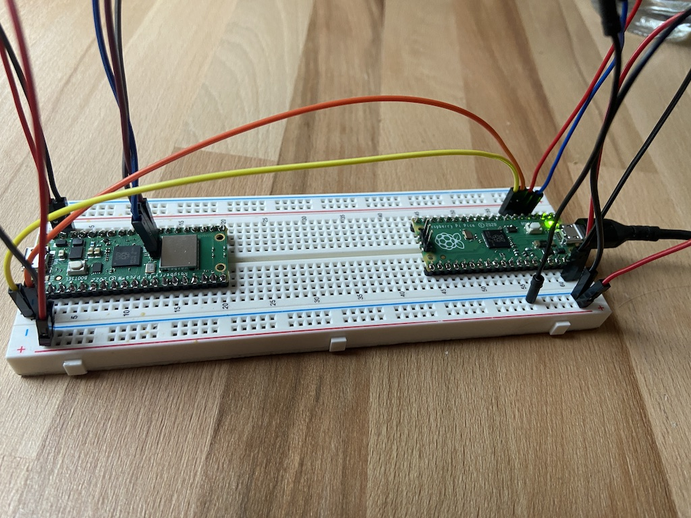
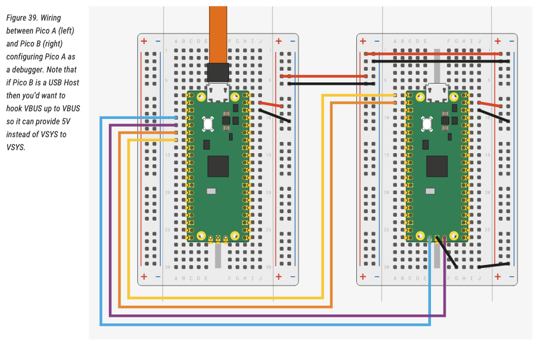
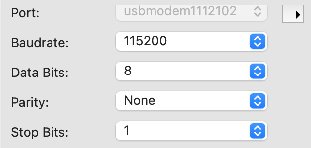

Did you ever wonder how to debug a microcontroller? With a Raspberry Pi Pico there's a simple solution: **Use another Raspberry Pi Pico** 😉!

What I worked on today is being able to prepare two Raspberry Pi Picos (one W and one without W) to debug executables. The one without Wifi will be used as a [Picoprobe](https://github.com/raspberrypi/picoprobe), the WiFi version as target later.



## Prerequisites

- if not already done, [install Homebrew](https://brew.sh/)
- install a serial terminal. My recommendation is [CoolTerm](https://coolterm.en.lo4d.com/windows)

## Building openocd

[In Raspberry Pi Pico's Getting Started Document](https://datasheets.raspberrypi.com/pico/getting-started-with-pico.pdf), they have a great explanation of how to build openocd (which is an open sourced on-chip debugger) and picoprobe. I will note down the Mac commands here, if you are on a different system please consult the linked Document:

```bash
# install dependencies
brew install libtool automake libusb wget pkg-config gcc texinfo
# create a pico directory whereever you like and navigate there
mkdir -p ~/pico
# clone openocd
git clone https://github.com/raspberrypi/openocd.git --branch rp2040 --depth=1
cd openocd
# export tex path
export PATH="/usr/local/opt/texinfo/bin:$PATH"`
# run bootstrapping script
./bootstrap
# run config script
./configure --disable-werror
# build
make -j4
# test
src/openocd
```

You should see this output:
```
Open On-Chip Debugger 0.10.0+dev-gc231502-dirty (2020-10-15-07:48)
Licensed under GNU GPL v2
For bug reports, read
http://openocd.org/doc/doxygen/bugs.html
embedded:startup.tcl:56: Error: Can't find openocd.cfg
in procedure 'script'
at file "embedded:startup.tcl", line 56
Info : Listening on port 6666 for tcl connections
Info : Listening on port 4444 for telnet connections
Error: Debug Adapter has to be specified, see "interface" command
embedded:startup.tcl:56: Error:
in procedure 'script'
at file "embedded:startup.tcl", line 56
```

It works? Good!

## Download and setup pico-sdk

```bash
# navigate back to your pico directory
# clone picoprobe and install submodules
git clone https://github.com/raspberrypi/pico-sdk.git
cd pico-sdk
git submodule update --init
```


## Building picoprobe 

```bash

# navigate back to your pico directory
# clone picoprobe and install submodules
git clone https://github.com/raspberrypi/picoprobe.git
cd picoprobe
git submodule update --init
# create build dir and switch
mkdir build && cd build
# setup build files
PICO_SDK_PATH=../../pico-sdk cmake ..
# build
make -j4
```

If everything went well, you see a file called `picoprobe.uf2` in your current directory.

## Building the pico examples

```bash
# navigate back to your pico directory
# clone picoprobe and install submodules
git clone https://github.com/raspberrypi/pico-examples.git
cd pico-examples
# create build folder and navigate
mkdir build && cd build
# setup build files using PICO_SDK_PATH env var and CMAKE_BUILD_TYPE compiler parameter, IMPORTANT!
PICO_SDK_PATH=../pico-sdk cmake -DCMAKE_BUILD_TYPE=Debug ..
# build hello serial:
cd hello_world/serial
make -j4
```

Make sure you can see a `hello_serial.elf` file in your current directory.

## Wiring up the two Picos

Nothing as simple as an image:


*(image taken from the linked [Getting Started Document](https://datasheets.raspberrypi.com/pico/getting-started-with-pico.pdf))*

The pico on the left using the yellow USB cable is your debugging `picoprobe`. **Yellow** and **orange** are for serial passthrough, **teal** and **purple** are for the Debug bus.

## Flashing Picoprobe

When attaching a USB Cable to your Picoprobe-Pico, hold down the `BOOTSEL` button on the board to make the Pico run in bootloader mode. On your mac you should see a external volume popping up with the name `RPI-RP2`. Copy the picoprobe software over and the device will restart automatically.

```bash
cd ~/pico/picoprobe
cp picoprobe.elf /Volumes/RPI-RP2/
```


## Finally, Debugging!


Now, open **another terminal** *[T2]*  and navigate to `~/pico/openocd`. To start the on-chip debugger service, run: 
```bash
src/openocd -f interface/cmsis-dap.cfg -c "adapter speed 5000" -f target/rp2040.cfg -s tcl
```
At the end of the output you should read: `Listening on port 3333 for gdb connections`. Yes? good!

Now, switch back to the terminal which you used to build 3 steps before *[T1]*, and run `arm-none-eabi-gdb` with the `hello_serial.elf` build file. This will connect to the on-chip debugger port you just opened and use the `hello_serial.elf` build for debugging.

```bash
arm-none-eabi-gdb -q -ex "target extended-remote :3333" hello_serial.elf
```

You should be able to see GDB output now.

```
❯ arm-none-eabi-gdb -q -ex "target extended-remote :3333" hello_serial.elf
Reading symbols from hello_serial.elf...
Remote debugging using :3333
warning: multi-threaded target stopped without sending a thread-id, using first non-exited thread
time_reached (t=...) at /Users/ts/code/pico/pico-sdk/src/rp2_common/hardware_timer/include/hardware/timer.h:116
116	    uint32_t hi_target = (uint32_t)(target >> 32u);
```

In *[T1]*, tell GDB to load the binary file to the remote pico by writing `load` into the gdb terminal:
```
(gdb) load
Loading section .boot2, size 0x100 lma 0x10000000
Loading section .text, size 0x44e8 lma 0x10000100
Loading section .rodata, size 0xfb4 lma 0x100045e8
Loading section .binary_info, size 0x28 lma 0x1000559c
Loading section .data, size 0x244 lma 0x100055c4
Start address 0x100001e8, load size 22536
Transfer rate: 16 KB/sec, 3756 bytes/write.
```

In the openocd *[T2]* Terminal you should see this output repeatedly, while the .elf file is loaded to the target chip:
```
target halted due to debug-request, current mode: Thread
xPSR: 0xf1000000 pc: 0x000000ea msp: 0x20041f00
```

Okay, perfect, switch back to *[T1]*, and place a breakpoint to `hello_serial.c:14`:
```
(gdb) b hello_serial.c:14
Breakpoint 1 at 0x10000310: file /Users/ts/code/pico/pico-examples/hello_world/serial/hello_serial.c, line 14.
Note: automatically using hardware breakpoints for read-only addresses.
```

Open your Terminal software, connect to your usb attached `picoprobe` with settings BAUD 115200 8-N-1:



Switch back to your GDB *[T1]* and run the software. For this, just type `r` and press `ENTER`. GDB will ask you if it should start the software from the beginning. Write yes. Now you should see the following output since you run into a breakpoint:

```
(gdb) r
The program being debugged has been started already.
Start it from the beginning? (y or n) y
Starting program: /Users/ts/code/pico/pico-examples/hello_world/serial/hello_serial.elf
target halted due to debug-request, current mode: Thread
xPSR: 0x01000000 pc: 0x00000184 msp: 0x20041f00
[New Thread 2]

Thread 1 hit Breakpoint 1, main () at /Users/ts/code/pico/pico-examples/hello_world/serial/hello_serial.c:14
14	        sleep_ms(1000);
```

In CoolTerm, you should see a `Hello World!` output. If this is the case, everything worked fine! In case you are not familiar with GDB debugging, I can just recommend [this GDB cheat sheet](https://darkdust.net/files/GDB%20Cheat%20Sheet.pdf). Some short commands:

- `r` for RUN the program, ctrl+c to stop the program
- `l` to print the code where you currently are
- `b [filename]:[line]` to set a breakpoint
- `c` to continue until the next breakpoint
- `n` to step to the next instruction

**Congrats, you can now do on-chip debugging on a Raspberry Pi Pico by using another Raspberry Pi Pico.**
