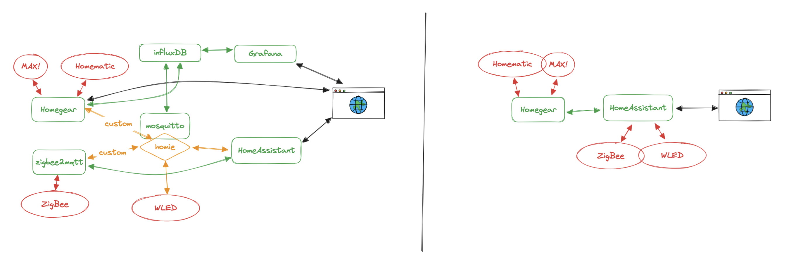
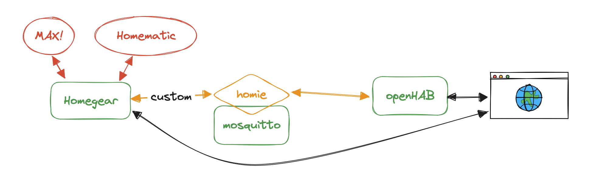
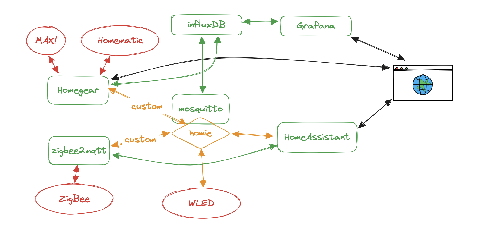
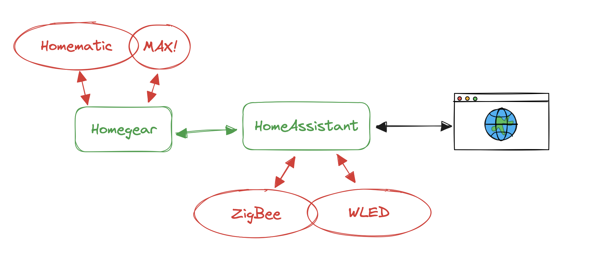

For some years, I have a homeautomation running in my apartment. I did not extend it over time by a lot, but I like to have reliable, low maintenance services, especially about temperature regulation and lighting. This is a story of radical reduction. I basically went from left to right in 5 hours (_there are zoom-in pictures in the following article_):

## How did this even happen?

Feature bleed. My home automation had those features:

- Heating thermostates (MAX) in every room
- Window sensors (HomeMatic) on most windows
- Temperature/Humidity sensors (Zigbee) in every room
- Some controllable power plugs (Zigbee)
- LED strips in office and living room
- ProxMox Virtualization Server (_this is not permanently running, so it's not able to run the homeautomation, but HA is controlling when it starts and stops automatically_)

This doesn't sound a lot, but it was.

This system evolved over time. I started with MAX Themostates and Homematic window sensors, which I connected to a Raspberry PI using a [custom flashed Max CubeCUL (german link)](https://blog.loetzimmer.de/2017/10/max-cube-umbau-zu-4-fach-netzwerk-cul.html) and [cod.m's CC1101 Raspberry Module](https://shop.codm.de/automation/Homegear/3/cc1101-raspberry-pi-spi-modul-v0.4), and [Homegear](https://Homegear.eu/) installed on Raspbian. 

For UI, I installed (openHAB)[https://www.openhab.org/].

To connect openHAB and Homegear, I implemented a Flow in Homegears internal NodeRED - which is called NodeBLUE - to custom map my thermostates to ["homie"-mqtt standard](https://homieiot.github.io/specification/), because openHAB is able to autodetect Homie devices via MQTT. 

So I needed an additional MQTT broker - mosquitto.  The System was the following:

- Software (running on raspberry pi)
    - Homegear (incl NodeBLUE flows)
    - OpenHAB for visualization
    - mosquitto as MQTT broker
- Custom Protocols
    - "homie" thermostates mapped in MQTT
    - "homie" window sensors mapped in MQTT

This was around 2020, the first stage.

From here, the system grew quite big over time. Since I don't want to elaborate each point with a own paragraph, I will just jot it down using bulletins:

- In 2020, I added 2 WLED striped in office and living room. Those stripes are connected to openHAB using custom MQTT homie integrations with NodeBLUE (Homegear) again...
- In 2021, I started adding Zigbee Devices. For that, I used cod.m's great [Raspberry Pi Module](https://shop.codm.de/automation/zigbee/33/zigbee-cc2652p2-raspberry-pi-module) (link to newer version). I installed Zigbee2MQTT, attached it to my mosquitto instance and built - again - custom homie mappings.
- Same year, I added Grafana for Monitoring and InfluxDB as da Database.
- Also same year, I tried to upgrade openHAB and had a unrecoverable error. Or, let's say it like that - I'm usually willing to spend some time fixing broken things, but if a re-setup seems to be faster, I will do that. So I ended up **switching openHAB to HomeAssistant**.

This system remained like this for long time, because I was severly annoyed by it's complexity and didn't want to touch it at all. Actually, in the occasions I tried to do something with it - for example updating the software components or Raspbian - I constantly broke the system. After a while, I just had absolutely no energy for it. It looked somehow like this (all running on a raspberry pi):

As you can see in the summary, this is just a grown system where you attach things one-by-one until you have an annoying monster. I have enough of this at work, but I don't want to have that in my appartment. So you see, feature and complexity bleed is even happning in just a very simple home automation.

## The big reduction

When I introduced my homelab server this year, I moved HomeAssistant from the Pi to the homelab server. But I recognised that the server does absolutely not need to run 24/7 and actually consumes a lot more power compared to the raspberry pi 4 which runs the home automation - actually 10W compared to 4W (which is both perfecly fine - but we all try to save energy right). So I wanted to have scheduled boots and shutdowns for my homelab, but also have the HomeAssistant UI available all the time. **This means, move HomeAssistant back to the raspberry pi**. 

At the same moment, I decided to update the OS, and all other software which...

**obviously completely messed up my installation**, especially Homegear. I spend 5-6 hours trying to fix everything, but as I mentioned earlier I'm usually not very eager to throw away stuff and do a clean sheet installation.

### Starting from scratch on the Raspberry

At this point, I wanted to do things very differently and use as little software as possible, so I don't run into problems when updating the components. Let it be Homegear, zigbee2mqtt, HomeAssistant, grafana or influx, in the last years I had issues with each of them during software updates. Not to speak of raspbian itself. It might be due to the fact that I do not update very often and if so, I instantly jump multiple versions. So my goals for the new system were the following:

- Have automated updates (_not yet done_)
- Have a good backup mechanism (done)
- Use very little software, and as much "native software" as possible.

Since I wanted to keep the sheets clean in Raspbian, I decided not to install software via apk, but use docker and docker-compose instead to manage the actual automation system in a reproducable way. The docker compose project is [available at my github account](https://github.com/tsmt09/homeautomation). 

Outside of docker, I only want to have the backup system and the operation system running.

The backups problem I solved by [just using a shell script](https://github.com/tsmt09/homeautomation/blob/main/backup.sh) which does a gzipped tar backup of the whole docker-compose project folder, including all configurations which are mounted into the containers. This backup is triggered by a cronjob once a day. On my Macbook, I also run a cronjob every hour to check if there are new backups via ssh and save them to my local disk. To me, this sounded as the most straight forward and easiest solution, utilizing long proven software.

In the end, this means that in case of a reinstallation I just need to

- change 2 files in /boot to make my raspbian able to use the connected hardware. Those are even in the Git Repo.
- install docker
- git clone, restore backup and docker-compose up 

to make the whole system work.

### Homeautomation

I just ended up with two containers are are part of the docker-compose file, and I will try as good as possible to keep it like that.

Homegear, I again use to connect to my MAX Thermostates using a CUL Cube and to my Homematic window sensors using the mentioned MAX CubeCUL and [CC1101 Module](https://shop.codm.de/automation/Homegear/3/cc1101-raspberry-pi-spi-modul-v0.4). AFAIK, HomeAssistant is not capable of utilizing the Cube so I basically just did the very basic setup and paired all the devices to Homegear, and then connected Homegear to HomeAssistant since it can act like a normal Homematic CCU.

_Btw, do you recognize that too many products in Homeautomation start with Home? This get's really confusing by now._

HomeAssistant will be the main driver of my automation from now on, and to me this feels very well. I was actually surprised how much of my old implementations can be covered by HomeAssistant by now. 

**What it has done for me**:

- Completey **get rid of MQTT and homie custom integrations** (this is the best part):
  - Control MAX Thermostates via Homegear CCU
  - Monitor Homematic window sensors via Homegear CCU
  - Covers all my Zigbee Actor and Sensor Hardware (weather sensors, power plugs, window sensors, routers) via Zigbee Integration and the mentioned [cod.m Raspberry Pi Module](https://shop.codm.de/automation/zigbee/33/zigbee-cc2652p2-raspberry-pi-module), **so I can get rid of zigbee2mqtt**.
  - Can natively connect to WLED for my lighting
- **Get rid of Influx+Grafana**
  - Can monitor all Sensors and Actors (Entities)
  - Can monitor information about host system and docker containers
  - Collects statistics and histories
  - Can show this as a graph
- Can still do all automations I implemented with NodeRED/NodeBLUE natively (see below). Even though I have to mention that I particularly don't like the automation flow of HomeAssistant yet. But I will try and see if I can get used to it.
- Automations I have been able to quickly implement yet:
  - Disable heating if windows are open
  - Shutdown homelab at 2am if no tasks are running (check by system load)
  - Wake-On-LAN homelab at 5:30pm (when I usually come home)

## Summary
I'm very happy with the last few days. I was able to drastically strip down my homeautomation they way I would like it to be. While doing this, I actually realized how this system was stressing me out. I was able to implement all automations I had before, use a lot less software and build a more robust backup and config management system at the same time.